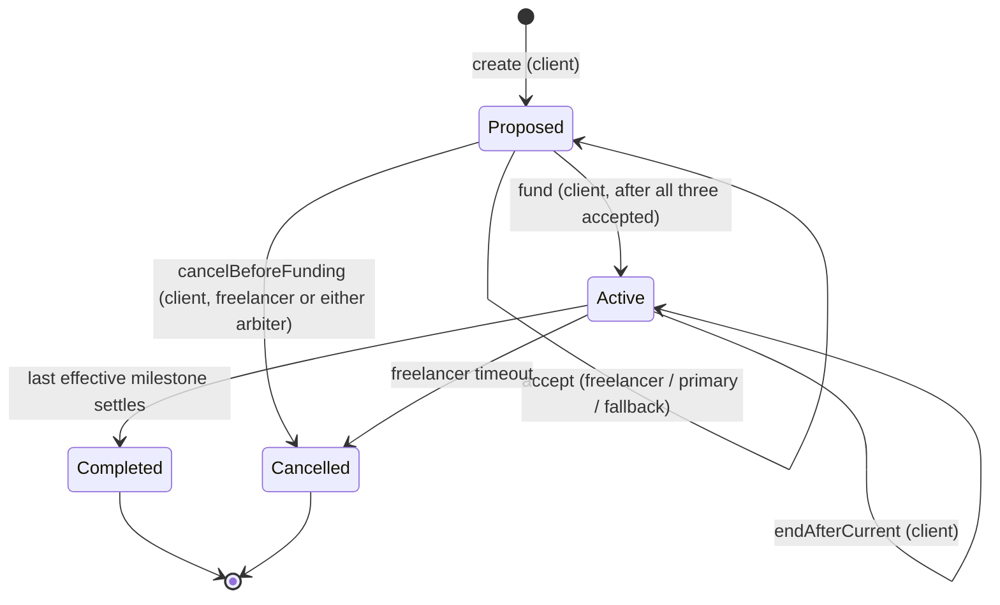

# Lifecycle, States and Timing

## Agreement status (stored)

| Status | Meaning |
|---|---|
| `Proposed` | Created. Waiting for freelancer and both arbiters to accept, and for funding. No ETH held. |
| `Active` | Funded. One milestone is current. |
| `Completed` | The last effective milestone settled. `locked == 0`. Credits may remain. |
| `Cancelled` | Ended by cancel-before-funding or by freelancer timeout. `locked == 0`. Credits may remain. |

`Completed` and `Cancelled` are terminal. Only `withdraw` works afterwards.

## Current-milestone phase (stored once per agreement, not per milestone)

| Phase | Meaning | Deadline field means |
|---|---|---|
| `Working` | Freelancer may submit | submission deadline |
| `Submitted` | Client reviews | review deadline |
| `RevisionRequested` | Freelancer may resubmit | revision-response deadline |
| `Disputed` | Arbitration | not used. `disputeOpenedAt` is used |

## Derived milestone status (view function, not stored)

- `index < currentIndex`: **Settled** (outcome is in the `MilestoneSettled` event).
- `index == currentIndex` and Active: the current phase.
- `currentIndex < index <= endIndex` and Active: **Pending**.
- Otherwise (`index > endIndex`, or the agreement is terminal and `index >= currentIndex`): **Voided**.

A timeout settles the current milestone as a full refund to the client and increments `currentIndex`, so the invariant "index < currentIndex means Settled" always holds.

## Timing constants

| Constant | Value |
|---|---|
| `SUBMISSION_WINDOW` | 14 days, from milestone activation |
| `REVIEW_WINDOW` | 7 days, from each submission |
| `REVISION_WINDOW` | 14 days, from each revision request |
| `PRIMARY_WINDOW` | 14 days, from dispute opening |
| `FALLBACK_WINDOW` | the next 14 days |
| `MAX_MILESTONES` | 20 |

Boundary: normal action requires `block.timestamp < deadline`. Timeout or escalation requires `block.timestamp >= deadline`.

## Agreement lifecycle

## Current-milestone phase machine (agreement is Active)

```mermaid
stateDiagram-v2
    [*] --> Working: activation (funding or previous settlement)
    Working --> Submitted: submit (freelancer, before deadline)
    Working --> Cancelled_: freelancer timeout (any account, at or after deadline)
    Submitted --> Settled_: approve (client, any time until dispute)
    Submitted --> RevisionRequested: requestRevision (client, before review deadline)
    Submitted --> Disputed: openDispute (client any time; freelancer at or after review deadline)
    RevisionRequested --> Submitted: submit (freelancer, before deadline)
    RevisionRequested --> Disputed: openDispute (freelancer, any time)
    RevisionRequested --> Cancelled_: freelancer timeout (any account, at or after deadline)
    Disputed --> Settled_: resolve (primary before +14d, fallback in [+14d, +28d))
    Disputed --> Settled_: default split (any account, at or after +28d)
    Settled_ --> Working: next milestone activates
    Settled_ --> Completed_: no further effective milestone
```

`Settled_`, `Cancelled_` and `Completed_` are agreement-level outcomes, shown here as end points of the phase machine.

## Deadline-driven actions are never automatic

Passing a deadline changes nothing by itself. A transaction must be mined. Until then the state is unchanged and the normal action remains available only on the `<` side of the boundary.
